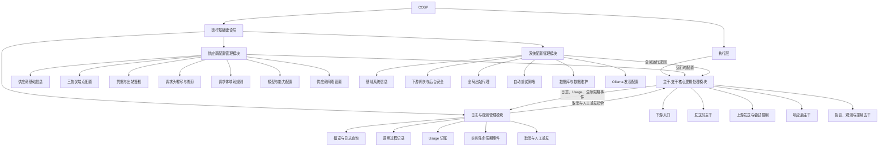
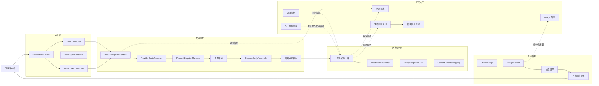
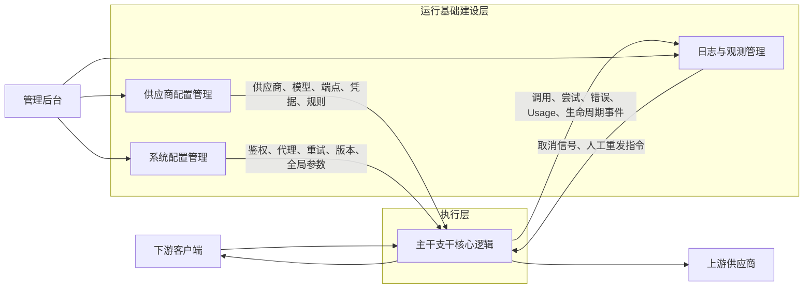

# COSP 业务模块视图

> 本文从产品与业务能力角度描述 COSP 的当前模块边界，帮助开发者先理解“系统提供哪些能力”，再映射到具体技术包。
>
> 本文不是 Java 包结构设计，也不替代主干实现说明。请求处理的技术结构与阶段顺序见 [`REQUEST_PIPELINE.md`](./REQUEST_PIPELINE.md) 和代码内的 [`pipeline/README.md`](../../src/main/java/com/kaixuan/copilot_ollama_proxy/pipeline/README.md)。

## 1. 总体划分

COSP 的业务架构先划分为两个层次，再在层内划分业务模块：

1. **运行基础建设层**：建立请求执行所需的配置、网络、安全、数据、观测和控制能力。
    - **供应商配置管理模块**：管理请求发给谁，以及针对该供应商如何构造请求。
    - **系统配置管理模块**：管理整个 COSP 实例的全局运行规则。
    - **日志与观测管理模块**：记录、查询和展示调用过程及用量，并提供运行期控制入口。
2. **执行层**：消费运行基础建设层提供的能力，实际处理每一次下游请求。
    - **主干-支干核心逻辑处理模块**：承接三个下游聊天端点，完成路由、翻译、装配、发送、重试、检测和响应整形。

“运行基础建设层”是业务能力视图中的上层划分，不等同于 Java 技术分层中的 `infrastructure` 包。它横跨部分 `application`、`observability`、`control`、`infrastructure` 和管理后台前端代码。



## 2. 运行基础建设层

运行基础建设层负责建立和维护请求能够执行的环境，但不直接承担一次请求的完整处理流程。它向执行层提供两类能力：

- **输入能力**：供应商、模型、协议端点、凭据、转换规则、代理、安全和重试参数。
- **承接能力**：调用日志、Usage 记账、生命周期事件、查询展示以及运行期控制入口。

其中，日志查询、聚合、持久化和 SSE 发布属于基础建设能力；取消和人工静默重发虽然由本层提供入口，但会直接作用于执行层的在途请求。

### 2.1 供应商配置管理模块

本模块回答：**请求最终发给谁，以及针对该供应商以什么配置发出去？**

```text
供应商配置管理
├─ 供应商基础信息
│  ├─ 新增、编辑、删除供应商
│  ├─ provider_key
│  ├─ display_name
│  ├─ 启用状态
│  └─ 展示与排序
│
├─ 三协议端点配置
│  ├─ Chat Base URL
│  ├─ Messages / Anthropic Base URL
│  ├─ Responses Base URL
│  ├─ 模型发现地址
│  └─ supported_protocols
│
├─ 凭据与出站鉴权
│  ├─ API Key 加密存储
│  ├─ Authorization: Bearer
│  ├─ x-api-key
│  ├─ 使用供应商配置值
│  └─ 从下游请求获取凭据
│
├─ 出站请求头管理
│  ├─ 下游请求头透传
│  ├─ Hop-by-hop / Host / Content-Length 过滤
│  ├─ 默认鉴权头清理与注入
│  ├─ 额外请求头覆写
│  ├─ 请求头删除
│  └─ {apiKey} 模板替换
│
├─ 请求体映射规则
│  ├─ V2 规则集与规则组
│  ├─ 协议作用域
│  ├─ 模板作用域
│  ├─ exists / equals 条件
│  ├─ set_value / delete / edit_object
│  ├─ 规则顺序
│  └─ 后端预览与 warnings
│
├─ 模型配置
│  ├─ 模型增删改查
│  ├─ 上游模型拉取
│  ├─ Tools / Vision 能力
│  ├─ 上下文窗口
│  ├─ reasoning_effort
│  ├─ Anthropic thinking
│  └─ max_output_tokens
│
└─ 供应商网络设置
   ├─ 是否启用出站代理
   └─ 运行时配置有效性
```

#### 2.1.1 关键业务边界

- `provider_key` 参与模型前缀和供应商路由，`display_name` 只用于显示。
- 供应商差异优先通过协议端点、鉴权头、请求头规则和请求体规则表达，不按供应商名称添加 Java 分支。
- 模型能力来自持久化配置，不按模型名猜测。
- API Key 的值属于供应商配置，但加密算法、主密钥和存储安全属于系统配置。
- 供应商可以决定是否使用代理，但代理服务器地址与认证信息属于系统级配置。

#### 2.1.2 主要代码区域

- 后端：`application/provider`、`application/runtime`、`application/catalog`、`application/discovery`、相关 `infrastructure/persistence`
- 前端：`frontend/src/features/provider-config`、`frontend/src/features/request-body-rules`
- 相关架构文档：[`AUTH_HEADER_ASSEMBLY.md`](./AUTH_HEADER_ASSEMBLY.md)、[`PROVIDER_NAMING_CONVENTION.md`](./PROVIDER_NAMING_CONVENTION.md)、[`ADAPTATIONS.md`](./ADAPTATIONS.md)

### 2.2 系统配置管理模块

本模块回答：**整个 COSP 实例应该按照什么全局规则运行？**

```text
系统配置管理
├─ 基础系统信息
│  ├─ Ollama 伪造版本号
│  └─ 全局默认参数
│
├─ 下游网关与后台安全
│  ├─ 聊天端点网关鉴权开关
│  ├─ 下游 API Key
│  ├─ Authorization Bearer 校验
│  ├─ x-api-key 校验
│  ├─ 管理员账号
│  └─ 管理 API JWT
│
├─ 全局出站网络
│  ├─ 出站代理地址
│  ├─ 代理认证
│  ├─ WebClient 配置
│  ├─ JDK DNS 解析
│  └─ 连接与响应超时
│
├─ 自动重试策略
│  ├─ 最大尝试次数
│  ├─ 禁止重试 / 无限重试
│  ├─ 首次与最大退避
│  ├─ 可重试错误判定
│  └─ Retry-After 识别与日志
│
├─ 数据库与数据维护
│  ├─ SQLite schema 与迁移
│  ├─ COSP_MASTER_KEY
│  ├─ API Key AES-256-GCM 加密
│  ├─ 日志保留策略
│  └─ 大载荷修剪与 payload_trimmed
│
└─ Ollama 发现配置
   ├─ GET /api/version
   ├─ GET /api/tags
   ├─ POST /api/show
   ├─ 模型目录聚合
   └─ 供应商模型探测
```

#### 2.2.1 与供应商配置的边界

| 配置问题 | 所属模块 |
|---|---|
| 某个供应商使用哪个 API Key | 供应商配置管理 |
| API Key 如何加密、主密钥是什么 | 系统配置管理 |
| 某个供应商发送 `Authorization` 还是 `x-api-key` | 供应商配置管理 |
| 下游访问三个聊天端点是否需要网关密钥 | 系统配置管理 |
| 某个供应商是否启用代理 | 供应商配置管理 |
| 代理服务器地址与认证 | 系统配置管理 |
| 某个模型的思考方式和输出上限 | 供应商配置管理 |
| 全局自动重试次数 | 系统配置管理 |
| `/api/version` 返回的版本号 | 系统配置管理 |

#### 2.2.2 主要代码区域

- 后端：`application/config`、`application/account`、`infrastructure/config`、`infrastructure/security`、`infrastructure/web`
- 前端：系统配置页面、认证 store、代理地址相关 feature
- 数据库变更流程：[`cosp-schema-migration-skill`](../../.github/skills/cosp-schema-migration-skill/SKILL.md)

### 2.3 日志与观测管理模块

本模块回答：**系统发生了什么、消耗了多少，以及管理员能够如何观察或干预？**

```text
日志与观测管理
├─ 管理后台查询
│  ├─ 系统概览
│  ├─ 调用日志列表与明细
│  ├─ 调用量与成功率
│  ├─ Token 用量统计
│  ├─ 缓存命中率
│  ├─ 供应商 / 模型维度汇总
│  └─ 时间序列、热力图与趋势
│
├─ 调用过程记录
│  ├─ 下游请求信息
│  ├─ 路由与协议选择结果
│  ├─ 上游请求信息
│  ├─ 每轮上游尝试
│  ├─ HTTP 状态码
│  ├─ 错误与响应载荷
│  ├─ 翻译前后帧信息
│  └─ payload_trimmed 状态
│
├─ Usage 记账
│  ├─ prompt_tokens
│  ├─ completion_tokens
│  ├─ cached_tokens
│  ├─ usage_raw
│  ├─ 协议级解析与归一化
│  └─ 跨事件合并
│
├─ 实时生命周期事件
│  ├─ 请求接收
│  ├─ 上游尝试与重试
│  ├─ 成功或失败
│  ├─ 调用落库完成
│  └─ 管理后台 SSE 推送
│
├─ 人工控制
│  ├─ 取消在途调用
│  ├─ 取消信号注册
│  ├─ 流式调用静默重发
│  └─ 重发状态通知
│
└─ 数据维护
   ├─ 保留日志与用量主体
   ├─ 清理历史大载荷
   ├─ 保持日志和用量时间覆盖关系
   └─ 失败调用也触发前端刷新
```

#### 2.3.1 内部层次

1. **采集层**：核心主干在执行期间产生尝试、响应帧、错误和 usage 信息。
2. **记录层**：观测端口和持久化实现写入调用日志及 usage。
3. **查询展示层**：管理 API 查询聚合数据，由 Vue 后台展示概览、明细、趋势和图表。
4. **控制层**：取消和人工静默重发作用于在途调用，与只读观测正交。

观测模块不反向承载核心业务决策。日志记录、生命周期通知和 usage 记账是主干调用的支干能力；取消与人工重发则属于独立的控制轴。

#### 2.3.2 主要代码区域

- 后端：`application/logging`、`application/usage`、`observability`、`control`、相关持久化实现
- 前端：`frontend/src/features/call-log`、`frontend/src/features/usage-series`、概览页面和图表组件

## 3. 执行层

执行层负责让请求真正流动起来。当前只有**主干-支干核心逻辑处理模块**属于执行层，供应商配置、系统配置和日志观测都是它依赖或调用的运行支撑能力。

执行层中的“支干”不只表示观测设施。请求翻译、响应翻译、协议请求体处理等协议支线同样属于执行层，并且必须汇回主干；日志、Usage、生命周期通知和控制则是与主干协作的正交支干。

### 3.1 主干-支干核心逻辑处理模块

本模块回答：**一次下游请求如何经过 COSP，最终形成上游请求并返回正确的下游响应？**

#### 3.1.1 五个组成部分

```text
主干支干核心逻辑处理
├─ 1. 下游入口
│  ├─ POST /v1/chat/completions
│  ├─ POST /v1/messages
│  ├─ POST /v1/responses
│  ├─ 网关鉴权
│  ├─ 请求解析
│  └─ 按下游协议渲染响应与错误
│
├─ 2. 发送前主干
│  ├─ 创建 RequestPipelineContext
│  ├─ 供应商与模型路由
│  ├─ 读取供应商支持协议
│  ├─ 上游协议调度
│  ├─ 跨协议请求翻译
│  ├─ 协议请求体归一化
│  ├─ 模型设置施加
│  ├─ 请求体规则执行
│  ├─ null 清理
│  ├─ 出站 URL 装配
│  └─ 出站请求头装配
│
├─ 3. 上游发送与尝试控制
│  ├─ Chat 上游执行器
│  ├─ Messages 上游执行器
│  ├─ Responses 上游执行器
│  ├─ WebClient 调用
│  ├─ 流式与非流式处理
│  ├─ 自动重试
│  ├─ 空响应门控
│  ├─ HTTP 错误解包
│  └─ 每轮尝试记录
│
├─ 4. 响应后主干
│  ├─ 响应解压
│  ├─ JSON / SSE 帧处理
│  ├─ 协议 Chunk 处理
│  ├─ 实质内容检测
│  ├─ Usage 解析
│  ├─ 跨协议响应翻译
│  ├─ 下游响应整形
│  └─ 状态码与错误体透传
│
└─ 5. 正交支干
   ├─ 调用日志记录
   ├─ Usage 记账
   ├─ 生命周期通知
   ├─ 管理后台 SSE
   ├─ 取消控制
   └─ 人工静默重发
```

#### 3.1.2 核心链路



#### 3.1.3 主要代码区域

- 协议入口：`api`
- 唯一请求主干及协议支线：`pipeline`
- 无 Spring 依赖的 DTO 和协议值对象：`protocol`
- 路由、供应商配置与运行时读取：部分 `application/runtime`、`application/provider`
- 观测和控制支干：`observability`、`control`
- 详细处理顺序：[`REQUEST_PIPELINE.md`](./REQUEST_PIPELINE.md)
- 主干结构和接入点：[`pipeline/README.md`](../../src/main/java/com/kaixuan/copilot_ollama_proxy/pipeline/README.md)

## 4. 两层之间的协作关系



典型请求中的两层协作顺序如下：

1. 核心模块从供应商配置管理模块取得供应商、模型、协议端点、API Key 和转换规则。
2. 核心模块从系统配置管理模块取得网关安全、出站代理、自动重试和全局参数。
3. 核心模块完成路由、翻译、请求装配、上游调用和响应处理。
4. 核心模块将调用过程、错误和 usage 交给日志与观测模块记录并推送。
5. 管理员可通过日志与观测模块取消在途调用，或对流式调用发起人工静默重发。

## 5. 业务视图与技术视图的映射

两层四模块是产品能力视图，Java 顶层包是技术职责视图，两者不是一一对应关系。

| 业务层 | 业务模块 | 主要技术区域 | 说明 |
|---|---|---|---|
| 运行基础建设层 | 供应商配置管理 | `application/provider`、`application/runtime`、`application/catalog`、`application/discovery`、部分 `infrastructure/persistence` | 配置会被执行层读取，但配置维护本身不属于请求主干 |
| 运行基础建设层 | 系统配置管理 | `application/config`、`application/account`、`infrastructure/config`、`infrastructure/security`、`infrastructure/web` | 提供全局参数、安全和基础设施配置 |
| 运行基础建设层 | 日志与观测管理 | `application/logging`、`application/usage`、`observability`、`control`、相关 persistence | 包含只读观测、持久化、查询展示和运行期控制入口 |
| 执行层 | 主干-支干核心逻辑 | `api`、`pipeline`、`protocol`，并调用部分 `application` | 负责一次请求的完整生命周期，协议支线也属于本层 |

不应为了匹配业务视图而把 Java 顶层包改造成 `foundation`、`execution` 或四个业务模块目录。请求主干天然会读取配置并发出观测事件，强行按业务层级分包会模糊现有依赖方向。业务文档使用“两层四模块”视图，代码定位和依赖约束继续使用现有技术分层。