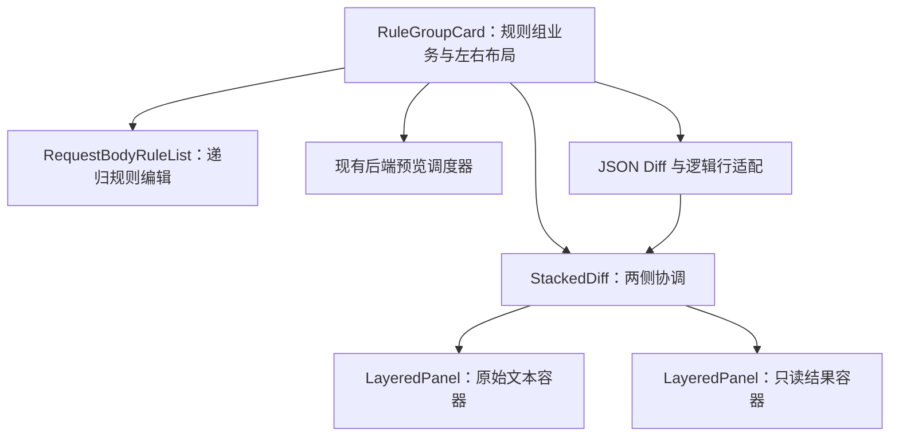

# RFC：请求体规则组左右布局与叠放 Diff 预览

- **日期**：2026-11-06（立项日）
- **状态**：已定稿，实施待开始
- **相关 ADR**：[ADR-0021：叠放 Diff 预览分离通用交互与请求体业务](../../adr/adr-0021-stacked-diff-preview.md)
- **分支**：尚未建立独立实现分支；本文档起草于 `feat/log-search`，不代表本功能属于日志检索。

## 背景

> **需求复述**：请求体映射规则配置目前把两份预览横向并排，再在下方铺开规则列表。
> 预览区偏矮，元信息、条件和嵌套规则的视觉层次不够清楚。希望每组改成顶部元信息、
> 下方约 1:2 的左右布局：左侧是可复用的双容器叠放 Diff 组件，右侧是该组规则。
> 两个容器只左右错位，通过悬停切换前后景；后景轻微模糊，前景背景约 66% 透明。
> 前景输入区获得焦点后，悬停不得切换层级。编辑仅发生在原始请求体一侧。
> 两份文本需要逻辑行对应与滚动协调；浮沉、透视和换行产生的视觉位置差异属于预期效果。
> 左侧高度跟随右侧规则区，并设最小高度；预设请求体选择移到适用协议多选框右侧。

本文记录已经确认的效果、实现边界与验收要求。所有实现阶段均尚未开始；文中的组件名和
建议路径用于划分职责，正式导出以实施时新增的组件 README 为准。

## 1. 现状调研

| 位置 | 当前职责与本次关联 |
|---|---|
| [`RequestBodyRuleEditor.vue`](../../../frontend/src/components/settings/request-body-rules/RequestBodyRuleEditor.vue) | 多规则组模态框；打开时复制草稿，应用时回写；提供可视化 / JSON 视图 |
| [`RuleGroupCard.vue`](../../../frontend/src/components/settings/request-body-rules/RuleGroupCard.vue) | 单组受控卡片；组元信息、双栏预览、警告和规则列表；本次页面重排的主要接入点 |
| [`RequestBodyRuleList.vue`](../../../frontend/src/components/settings/request-body-rules/RequestBodyRuleList.vue) / [`RequestBodyRuleItem.vue`](../../../frontend/src/components/settings/request-body-rules/RequestBodyRuleItem.vue) | 递归规则编辑；条件行包含路径、操作符、值类型和取值控件，缩窄后需要重新核对换行 |
| [`DiffJsonNode.vue`](../../../frontend/src/components/settings/request-body-rules/DiffJsonNode.vue) | 只读 JSON Diff 树；未修改项为灰色，新增 / 修改为强调色，删除为红色加删除线 |
| [`diff.ts`](../../../frontend/src/features/request-body-rules/diff.ts) | 语义 Diff；数组使用相等锚点与相似度配对，已有规模限制；节点尚不携带文本行范围 |
| [`preview.ts`](../../../frontend/src/features/request-body-rules/preview.ts) | 后端预览请求的防抖、竞态处理、加载态与失败保留旧结果；不是前端规则引擎 |

当前卡片还承担「原始输入框 resize → 结果区高度跟随」和双向滚动比例同步。
比例同步不能表达新增、删除后的行对应关系，需要替换为按对比行映射的同步方式。

2026-11-06 调研时，浏览器视口为 1150 × 613，规则组内容区约 954px 宽，输入区约
140px 高，示例 JSON 有 29 行。该数值只是现状样本，不作为新组件尺寸契约。

## 2. 目标与范围

### 2.1 本次实现

1. 规则组下方形成左侧叠放预览、右侧规则编辑的约 1:2 布局。
2. 抽出单容器组件与双容器组合组件，具备独立于请求体规则的复用边界。
3. 实现仅左右错位、前后景浮沉、后景模糊、前景半透明背景与平滑过渡。
4. 实现悬停切换、焦点锁定，以及键盘和触屏的明确切换入口。
5. 实现文本逻辑行映射与基于该映射的滚动协调，保留 Diff 状态表达。
6. 将预设请求体选择移到适用协议右侧，保持模板选择与自定义样本的现有语义。
7. 保留每组独立预览、格式化、复制、错误、警告、加载与过期结果提示。

### 2.2 明确不做的事

- 不调整后端规则执行、预览 API、V2 规则格式或数据库结构，不在前端重建规则引擎。
- 不增加转换结果编辑，也不让多组预览串联；每组仍用自己的样本调试自己的规则。
- 不要求两份文本在屏幕上的每个像素重合，不实现上下错位、拖动换位或持续漂浮动画。
- 不向原始 JSON 草稿或复制结果插入用于对齐的空行、删除文本等展示内容。
- 不借本功能更换全站字体、主题或规则输入控件，不修改日志检索功能。
- 不在此阶段发布独立 npm 包；先通过目录、导出和使用文档支持迁移复用。

## 3. 规则组页面布局

### 3.1 区域组织

```text
规则组卡片
├─ 元信息：序号 / 规则组名 / 适用协议 / 预设请求体 / 启用与组操作
├─ 无适用协议时的提示
└─ 内容区（同一行，约 1:2）
   ├─ 左：StackedDiff
   │  ├─ 请求体编辑区容器（可编辑，靠左）
   │  └─ 转换后请求体容器（只读，相对向右偏移）
   └─ 右：该组规则标题与操作 / 警告 / 递归规则列表
```

JSON 语法错误和预览失败等提示靠近对应文本容器；规则执行警告放在右侧规则区域，
保留字段路径和消息。组级的「无适用协议」提示仍放在元信息下方。

### 3.2 宽度与高度

- 内容区使用两列布局，比例为 1:2，列内容允许收缩；控件的固有宽度不能把弹窗撑出横向滚动。
- 右侧规则区的自然高度决定内容区高度，同时设置满足双容器展示的最小高度。
- 左侧叠放区填满内容区高度，两个容器的内容区再扣除各自标题、操作和提示所占高度。
- 左侧容器不凭 JSON 行数反向撑高整组；长文本在容器内滚动。右侧随新增、删除和嵌套规则自然增减高度。
- 规则组很长时沿用外层模态框的纵向滚动，不先给右侧另加固定高度滚动窗口。
- 现有 textarea autosize 和手动纵向 resize 需要退出高度控制链，改为适应分配到的空间。
  保留编辑控件，避免左侧拖拽或文本测量与右侧高度形成反馈循环。
- 优先由布局实现两列等高；确需尺寸观测时，观测右侧或明确的父布局，不能让左右相互测量、相互设高。

具体最小高度、错位距离与窄屏排列在阶段 4 依据实测确定。首轮保留用户要求的 1:2，
不因现状宽度推测提前改变比例；窄屏至少保证控件可访问、文本可滚动、页面不横向溢出。

### 3.3 预设请求体选择

预设请求体多选紧跟适用协议右侧，空间不足时按完整的「标签 + 控件」单元换行。
它仍只控制当前组的预览样本：多模板组合、自定义状态、手工输入切到自定义、清空选择等
行为沿用现有实现，不因移动位置而变成协议配置或改变实际出站请求体。

## 4. 叠放与视觉状态

### 4.1 空间关系

两个容器顶部对齐，只在水平方向错开。编辑容器在左，结果容器相对右移；各自空间位置
与当前层级分开管理，换前后景不交换左右位置。两种状态下均须留有可辨认、可操作的后景
露出区域，作为悬停及主动切换入口，不能让后景完全不可达。

浮沉可由层级、阴影和轻微深度变化共同表达；深度变化不能另行引入上下错位。

### 4.2 视觉状态规格

| 属性 | 前景 | 后景 |
|---|---|---|
| 内容清晰度 | 标题、文字、控件与光标清晰 | 容器整体轻微高斯模糊 |
| 背景 | 约 66% 透明，即约 34% 不透明 | 作为后层底面，具体底色浓度实测校准 |
| 层级与阴影 | 较高层级及相应阴影 | 较低层级及较弱阴影 |
| 交互入口 | 正常编辑、选取、滚动或操作 | 露出区域用于切换；键盘能主动进入 |

**模糊直接附加在后景容器上**，不依赖前景 `backdrop-filter` 去模糊后层。
前景背景的透明度通过背景色 alpha 表达，不能对整个前景设置 0.34 的 `opacity`，
否则标题、Diff 字体和光标也会一起变淡。

前后景交换时，模糊强度、背景色 alpha、阴影与深度状态平滑变化。`z-index` 是离散的
绘制顺序，不能把数值插值当成完整动效；需要与这些可过渡属性协同切换。
模糊强度和动效时长作为可调参数，初版实测后记录，不在本文提前固定。

## 5. 层级切换与焦点保护

### 5.1 状态与事件

组合组件统一持有当前前景及焦点锁；每个规则组独立一份。实施初始默认原始编辑容器
在前，鼠标离开后保持最近一次前景，不自动复位。它们是实施默认值，不改变已确认效果。

| 事件 | 状态处理 |
|---|---|
| 无焦点锁，鼠标进入后景露出区域 | 将该容器切到前景 |
| 鼠标仍在当前前景内移动 | 保持层级 |
| 前景文本区获得焦点 | 锁定当前前景，覆盖输入、选取、中文输入法组合输入过程 |
| 锁定期间鼠标进入后景 | 忽略悬停切换，不调用 blur，不重建输入区 |
| 文本区与该容器相关操作均失焦 | 解除锁定；不补执行锁定期间缓存的悬停意图 |
| 用户主动点击另一侧标题切换入口，或用键盘进入另一侧 | 允许明确的切换，并按实际焦点更新锁定对象 |
| 请求预览完成、规则变动、错误或尺寸变化 | 只更新内容或尺寸，不抢焦点、不重置当前前景 |

锁定规则针对自动悬停切换；用户主动离开编辑区、选择另一容器属于明确操作。
不能为了「解锁」主动让 textarea 失焦。鼠标命中区域也不能随浮沉反复触发互换，
导致指针不动时两张容器来回抖动。

### 5.2 内容状态保留

两份文本内容在层级交换时持续挂载，不能用条件销毁、变更 key 或重新赋值来模拟浮沉。
切换与预览更新必须保留原始草稿、焦点、光标、选区、输入法状态和两侧滚动位置。
只读结果侧的文本选取与复制同样不能被意外悬停切换打断。

### 5.3 键盘、触屏与减少动态效果

- 两侧标题区提供可聚焦的明确切换入口，用 Enter / Space 激活；触屏通过点击激活。
- 从键盘进入后景的可聚焦内容时，先将该侧带到前景，避免焦点落在被遮挡的输入区。
- 后景是可访问的另一份内容，不能仅为视觉层级把整张卡片永久设为 `aria-hidden` 或 `inert`。
- `prefers-reduced-motion` 下取消浮沉位移和渐变动画，保留明确的层级、焦点保护和可读状态。
- 不拦截编辑器已有的文本快捷键或模态框关闭语义。

## 6. 文本逻辑行对齐与滚动

### 6.1 「行对应」的定义

对齐指两侧文本之间的**逻辑对应关系**，不要求相同的原始行号，也不要求屏幕 y 坐标相等。
例如删除前部字段后，原始第 12 行可能对应结果第 9 行；这对行仍必须关联。
浮沉透视、容器左右偏移及软换行形成的视觉差异不作为缺陷。

实现需区分三类数据：

| 数据 | 定义 |
|---|---|
| 原始文本行 | 用户当前草稿按换行符划分的真实行；用于光标、编辑与源文本定位 |
| 结果文本行 | 后端输出经展示序列化后的真实行；复制时输出这份 JSON |
| 对比展示行 | 对应两侧的一组行，可含展示占位或删除痕迹；不是新的请求体内容 |

对比行模型至少表达稳定行标识、可空的原始 / 结果行号或行范围，以及
`same` / `changed` / `added` / `deleted` 状态。一对多的改写可用连续行范围表示。
新增一侧没有源行，删除一侧没有结果行，不能伪造真实行号。

### 6.2 JSON 语义与编辑草稿

- 保留现有 JSON 语义 Diff 的状态和数组配对能力，不能退回按数组下标逐位对比，
  让「删除一个元素」看起来像后续所有元素都被修改。
- 现有 Diff 树没有文本来源范围，需要由 JSON 适配逻辑补充来源位置、展开为行模型。
  通用叠放组件消费行映射与文本展示，不理解规则操作、协议或供应商。
- 用户草稿可能含任意缩进、空行或紧凑 JSON；源行定位必须尊重实际草稿。
  不能在每次输入后强制格式化，或仅对 `JSON.stringify` 后的副本对齐却声称对应真实源行。
- 对齐占位、删除标记和行号属于展示层。不得通过改 textarea 的 value 注入空行；
  如需占位，必须放在独立展示层并保持输入光标与真实文本的映射。
- 结果侧继续只读。Diff 中可以保留删除痕迹，复制仍取真实转换结果，不含痕迹、占位和行号。
- `DiffJsonNode.vue` 可以适配或替换为行渲染；验收依据是差异语义和行映射正确，
  不要求保留当前逐节点 DOM 结构。

### 6.3 预览快照与无效 JSON

每份成功预览及其行映射需要关联产生该结果的输入样本。请求仍由现有后端调度器执行，
行适配层需保留对应的输入快照，不能把旧结果直接与不相关的新草稿当成同一版本展示。

输入暂时无效时保留草稿、显示语法错误，结果区保留上次可用结果并明确其状态；
新结果尚未到达或请求失败时也保留现有的加载 / 过期 / 失败提示。
无法对当前文本建立可靠行映射时，暂停该版本的联动并提示，不能退回滚动比例后仍宣称行已对齐。

### 6.4 滚动协调

以前景侧可见的逻辑行及行内偏移为锚点，按行映射定位另一侧；不能简单同步
`scrollTop / (scrollHeight - clientHeight)`。新增 / 删除行取邻近的有效对应锚点，
连续占位区也应有稳定、可测试的定位结果。

软换行通过实际文本布局把逻辑行转换为该侧滚动位置；它不改变逻辑行号。
双向同步需防止回调循环。层级切换延续对齐位置，不在切换时跳回顶部。
Diff 与行映射在输入 / 结果变化时计算，滚动和悬停不得反复重算整份差异。

## 7. 组件边界与接入



| 单元 | 职责 |
|---|---|
| `LayeredPanel` | 标题、标题操作、内容与提示插槽；根据前后景状态呈现模糊、背景、阴影；上报指针与焦点事件 |
| `StackedDiff` | 复用两个容器；统一决定谁在前、焦点锁和切换入口；消费行映射及滚动接口协调两侧 |
| 通用状态 / 行模型模块 | 可单测的层级状态迁移、行映射类型与锚点定位；不引用请求体规则业务 |
| `RuleGroupCard` | 保持受控组数据；管理原始草稿、模板、预览、格式化、复制、错误和警告；提供内容与行适配 |
| JSON 行适配模块 | 复用语义 Diff，建立真实源文本、结果文本与对比行之间的对应；不执行请求体规则 |

建议通用组件放入 `frontend/src/components/stacked-diff/`，提供 `index.ts` 和 README；
状态逻辑可用目录内 `useStackedLayers.ts`，纯数据模块使用小写命名。
JSON 专属适配放在 `frontend/src/features/request-body-rules/`。
这些是待创建位置，当前尚无对应组件文件。

通用组件通过插槽、数据与事件接入内容，不能引用 `@/api`、Pinia、`RuleGroup`、
`WireProtocol` 或项目主题 SCSS 才能工作。样式通过局部 CSS 变量提供默认值，
COSP 接入层映射项目色值。首轮接入继续复用现有编辑控件。
可复用性通过一个不加载规则业务的双文本示例检查，不以创建独立包作为完成标准。

## 8. 分阶段实施计划

| 阶段 | 工作 | 完成标准 |
|---|---|---|
| 1：通用叠放容器 | 单容器、组合组件、状态逻辑、局部样式变量、独立双文本示例与组件 README | 左右错位、前后景效果、焦点锁、键盘 / 触屏入口可独立演示；状态迁移测试通过 |
| 2：行模型与同步 | 补充 JSON 来源位置、差异行模型、滚动锚点、快照对应与无效输入处理 | 增删改及数组位移映射正确；真实草稿保持原样；逻辑行同步测试通过 |
| 3：规则组接入 | 约 1:2 布局、头部模板迁移、动态高度、提示与现有操作接线；移除旧高度 / 比例同步 | 每组独立运行；草稿、格式化、复制、预览与规则编辑行为回归通过 |
| 4：浏览器校准与收尾 | 实测尺寸、长文本、长规则、嵌套规则、焦点 / 输入法、动效与对比可读性；记录参数 | 下方验收项完成；文档同步实际契约并追加实施记录 |

按依赖顺序实施，每阶段记录实际偏差及原因；不要回写已定稿计划来掩盖变更。
阶段 4 可以调整尺寸和动效参数，若改变只左右错位、约 1:2、模糊对象、编辑范围或
焦点规则等已确认行为，需要作为方案变化单独记录。

## 9. 风险与对策

| 风险 | 对策 |
|---|---|
| 左侧约 1/3 再扣错位后，长行阅读空间减少 | 先实现约定比例，实测软换行和内部滚动；错位与最小尺寸作为可调参数记录 |
| 前景透出后景后文字重影，Diff 颜色不易辨认 | 以后景轻微模糊配合背景 alpha 和阴影；以真实 JSON 校准可读性，保持前景文字全强度 |
| 右侧条件和嵌套规则缩窄后溢出 | 按容器宽度处理控件换行和最小宽度，不靠缩小字体或截断操作入口解决 |
| 指针命中区域随动效变化，造成反复切换 | 保持稳定的露出区域；只对有效进入事件激活，测试指针不动时不会持续互换 |
| 行对齐占位破坏原始文本或光标 | 分开真实草稿与展示行模型；测试任意缩进、空行、紧凑 JSON 和中文输入法 |
| 旧预览结果与新草稿被错误配对 | 行映射绑定输入快照；过期或无效版本明确提示并暂停不可靠联动 |
| 双份长文本、模糊与行测量影响响应 | 保留现有 Diff 规模保护，避免滚动重算；在大样本中检查输入、悬停与滚动响应 |

## 10. 验证与验收清单

以下均为实施后的待验收项；本次文档落地不代表功能已通过验证。

- [ ] 元信息下方形成约 1:2 的左右布局，模板选择位于适用协议右侧，组内控件不横向溢出。
- [ ] 两张容器只左右错位，切换不交换左右位置；任一侧在后景时都有可发现的激活入口。
- [ ] 后景模糊、前景背景约 66% 透明，前景文字与光标清晰；切换过渡平滑。
- [ ] 无焦点锁时悬停后景可切换；编辑、选取或中文组合输入时不会因悬停而切换。
- [ ] 失焦不重放旧悬停；主动标题操作、键盘进入和触屏点击可切换，焦点始终可见。
- [ ] 切换不销毁内容，不丢草稿、光标、选区及滚动位置；两组之间的前景状态互不影响。
- [ ] 规则为空、单条、增删、条件展开和多层嵌套时，最小高度有效，左侧随右侧高度响应。
- [ ] 新增、删除、改写、整段结构替换及数组头 / 中部删除均有正确逻辑行对应，长行软换行不改变行号。
- [ ] 用户原有的缩进和空行保留，输入不会被自动格式化；复制结果不含删除痕迹、占位和行号。
- [ ] 无效 JSON、首次加载、预览失败、过期结果和快速连续修改都有正确提示，旧结果不冒充最新映射。
- [ ] 双向滚动按对应行定位，无反馈循环；视觉位置偏差按 §6.1 判断，不要求逐像素重合。
- [ ] 格式化、模板组合 / 自定义、复制、启停、组排序 / 删除、应用 / 取消及 JSON 视图行为回归通过。
- [ ] 键盘 / 触屏、减少动态效果、窄窗口和普通桌面窗口均可使用，后台其他模态框不受样式影响。
- [ ] 通用双文本示例不加载 COSP 规则业务，组件 README 说明导入、插槽、事件、样式变量和焦点契约。

自动化重点覆盖层级状态、焦点锁和延迟事件、行映射、增删锚点、快照与草稿保留；
沿用已有 Diff、模板和异步预览测试验证业务语义。编辑后先检查诊断，再运行聚焦 Vitest、
`vue-tsc -b`，接入完成后按影响范围运行前端测试及构建。构建会覆写后端静态资源目录，
按[前端约定](../../../.github/instructions/frontend.instructions.md)执行。

浏览器检查使用已运行的前端与人工样本；浮沉、透明度、尺寸和输入法需要实际交互确认，
不能只靠单测。若需要另外启动服务或进行真实后端 HTTP 联测，再按项目操作边界安排。

## 11. 文档影响

- 本 RFC 保存功能完整档案；[ADR-0021](../../adr/adr-0021-stacked-diff-preview.md)保存组件边界与交互取舍。
- `docs/README.md` 与 RFC 索引增加入口。当前架构文档不提前把待实现组件写成现有实现。
- 实施时新增通用组件目录 README，作为正式 Props / Events / Slots、行映射及主题变量的真源。
- 接入后同步 `RuleGroupCard`、`RequestBodyRuleEditor` 的说明及前端约定中有关双栏预览的描述。
- 本次没有 API、持久化和协议变化，相关契约无需变更；功能合并前仍执行文档影响检查。

## 12. 实施记录

### 12.1 方案定稿（2026-11-06）

已完成现状调研并确认布局、后景模糊、前景背景透明度、仅左右错位、原始侧可编辑、
焦点保护及逻辑行对齐要求。本次新增 RFC 与 ADR，并更新文档索引。
阶段 1～4 尚未开始，无功能实现或功能验收结果。

待实施实测后记录的参数：水平错位距离、内容区最小高度、模糊强度、过渡时长、
深度 / 阴影强度以及窄屏换行方式。它们不阻塞开始实现，校准时遵守本文已确认行为。
