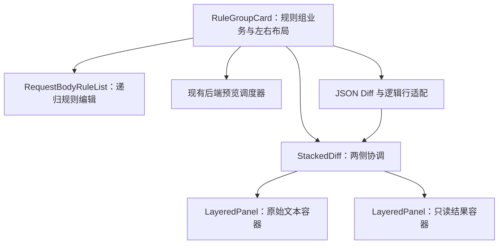

# RFC：请求体规则组左右布局与叠放 Diff 预览

- **日期**：2026-11-06（立项日）
- **状态**：实施中（[阶段 1](#stacked-diff-stage-1)～[阶段 3](#stacked-diff-stage-3)、[试用反馈](#stacked-diff-ui-feedback)与[共享虚拟行](#stacked-diff-virtual-rows)已完成；阶段 4 部分浏览器验证，系统输入法 / 剪贴板待人工）
- **相关 ADR**：[ADR-0021：组件分层](../../adr/adr-0021-stacked-diff-preview.md)、[ADR-0022：试用校准与编辑侧焦点锁](../../adr/adr-0022-stacked-diff-editing-lock.md)、[ADR-0023：JSON 源行定位](../../adr/adr-0023-json-text-line-locations.md)、[ADR-0024：2:3 宽度比例](../../adr/adr-0024-stacked-diff-width-balance.md)、[ADR-0025：共享虚拟行与编辑器占位](../../adr/adr-0025-virtual-diff-rows.md)
- **分支**：尚未建立独立实现分支；本文档起草于 `feat/log-search`，不代表本功能属于日志检索。

## 背景

> **需求复述**：请求体映射规则配置目前把两份预览横向并排，再在下方铺开规则列表。
> 预览区偏矮，元信息、条件和嵌套规则的视觉层次不够清楚。希望每组改成顶部元信息、
> 下方约 1:2 的左右布局：左侧是可复用的双容器叠放 Diff 组件，右侧是该组规则。
> 两个容器只左右错位，通过悬停切换前后景；后景轻微模糊，前景背景设 30% 透明。
> 处于编辑状态的容器获得焦点后，悬停不得切换层级；只读展示容器聚焦不锁。编辑仅发生在原始请求体一侧。
> 两份文本需要逻辑行对应与滚动协调；浮沉、透视和换行产生的视觉位置差异属于预期效果。
> 左侧高度跟随右侧规则区，并设最小高度；预设请求体选择移到适用协议多选框右侧。

本文记录已经确认的效果、实现边界与验收要求。下文设计与计划为定稿时基线，实际进展及
偏差按阶段追加至 §12；正式导出以[组件 README](../../../frontend/src/components/stacked-diff/README.md)为准。
当前宽度比例已根据试用反馈由 1:2 调整为 **2:3**；源侧行号与无文字侧边的变更见
[试用反馈记录](#stacked-diff-ui-feedback)。滚动现用共享虚拟行，源侧占位由 CodeMirror
装饰提供，见 [§12.8](#stacked-diff-virtual-rows)；下文原计划与历史验收保留用于追溯。

## 1. 现状调研

| 位置 | 当前职责与本次关联 |
|---|---|
| [`RequestBodyRuleEditor.vue`](../../../frontend/src/components/settings/request-body-rules/RequestBodyRuleEditor.vue) | 多规则组模态框；打开时复制草稿，应用时回写；提供可视化 / JSON 视图 |
| [`RuleGroupCard.vue`](../../../frontend/src/components/settings/request-body-rules/RuleGroupCard.vue) | 单组受控卡片；组元信息、双栏预览、警告和规则列表；本次页面重排的主要接入点 |
| [`RequestBodyRuleList.vue`](../../../frontend/src/components/settings/request-body-rules/RequestBodyRuleList.vue) / [`RequestBodyRuleItem.vue`](../../../frontend/src/components/settings/request-body-rules/RequestBodyRuleItem.vue) | 递归规则编辑；条件行包含路径、操作符、值类型和取值控件，缩窄后需要重新核对换行 |
| [`DiffJsonNode.vue`](../../../frontend/src/components/settings/request-body-rules/DiffJsonNode.vue) | 只读 JSON Diff 树；未修改项为灰色，新增 / 修改为强调色，删除为红色加删除线 |
| [`diff.ts`](../../../frontend/src/features/request-body-rules/diff.ts) | 语义 Diff；数组使用相等锚点与相似度配对，已有规模限制；节点尚不携带文本行范围 |
| [`preview.ts`](../../../frontend/src/features/request-body-rules/preview.ts) | 后端预览请求的防抖、竞态处理、加载态与失败保留旧结果；不是前端规则引擎 |

当前卡片还承担「原始输入框 resize → 结果区高度跟随」和双向滚动比例同步。
比例同步不能表达新增、删除后的行对应关系，需要替换为按对比行映射的同步方式。

2026-11-06 调研时，浏览器视口为 1150 × 613，规则组内容区约 954px 宽，输入区约
140px 高，示例 JSON 有 29 行。该数值只是现状样本，不作为新组件尺寸契约。

## 2. 目标与范围

### 2.1 本次实现

1. 规则组下方形成左侧叠放预览、右侧规则编辑的约 1:2 布局。
2. 抽出单容器组件与双容器组合组件，具备独立于请求体规则的复用边界。
3. 实现仅左右错位、前后景浮沉、后景模糊、前景半透明背景与平滑过渡。
4. 实现悬停切换、焦点锁定，以及键盘和触屏的明确切换入口。
5. 实现文本逻辑行映射与基于该映射的滚动协调，保留 Diff 状态表达。
6. 将预设请求体选择移到适用协议右侧，保持模板选择与自定义样本的现有语义。
7. 保留每组独立预览、格式化、复制、错误、警告、加载与过期结果提示。

### 2.2 明确不做的事

- 不调整后端规则执行、预览 API、V2 规则格式或数据库结构，不在前端重建规则引擎。
- 不增加转换结果编辑，也不让多组预览串联；每组仍用自己的样本调试自己的规则。
- 不要求两份文本在屏幕上的每个像素重合，不实现上下错位、拖动换位或持续漂浮动画。
- 不向原始 JSON 草稿或复制结果插入用于对齐的空行、删除文本等展示内容。
- 不借本功能更换全站字体、主题或规则输入控件，不修改日志检索功能。
- 不在此阶段发布独立 npm 包；先通过目录、导出和使用文档支持迁移复用。

## 3. 规则组页面布局

### 3.1 区域组织

```text
规则组卡片
├─ 元信息：序号 / 规则组名 / 适用协议 / 预设请求体 / 启用与组操作
├─ 无适用协议时的提示
└─ 内容区（同一行，约 1:2）
   ├─ 左：StackedDiff
   │  ├─ 请求体编辑区容器（可编辑，靠左）
   │  └─ 转换后请求体容器（只读，相对向右偏移）
   └─ 右：该组规则标题与操作 / 警告 / 递归规则列表
```

JSON 语法错误和预览失败等提示靠近对应文本容器；规则执行警告放在右侧规则区域，
保留字段路径和消息。组级的「无适用协议」提示仍放在元信息下方。

### 3.2 宽度与高度

- 内容区使用两列布局，比例为 1:2，列内容允许收缩；控件的固有宽度不能把弹窗撑出横向滚动。
- 右侧规则区的自然高度决定内容区高度，同时设置满足双容器展示的最小高度。
- 左侧叠放区填满内容区高度，两个容器的内容区再扣除各自标题、操作和提示所占高度。
- 左侧容器不凭 JSON 行数反向撑高整组；长文本在容器内滚动。右侧随新增、删除和嵌套规则自然增减高度。
- 规则组很长时沿用外层模态框的纵向滚动，不先给右侧另加固定高度滚动窗口。
- 现有 textarea autosize 和手动纵向 resize 需要退出高度控制链，改为适应分配到的空间。
  保留编辑控件，避免左侧拖拽或文本测量与右侧高度形成反馈循环。
- 优先由布局实现两列等高；确需尺寸观测时，观测右侧或明确的父布局，不能让左右相互测量、相互设高。

具体最小高度、错位距离与窄屏排列在阶段 4 依据实测确定。首轮保留用户要求的 1:2，
不因现状宽度推测提前改变比例；窄屏至少保证控件可访问、文本可滚动、页面不横向溢出。

### 3.3 预设请求体选择

预设请求体多选紧跟适用协议右侧，空间不足时按完整的「标签 + 控件」单元换行。
它仍只控制当前组的预览样本：多模板组合、自定义状态、手工输入切到自定义、清空选择等
行为沿用现有实现，不因移动位置而变成协议配置或改变实际出站请求体。

## 4. 叠放与视觉状态

### 4.1 空间关系

两个容器顶部对齐，只在水平方向错开。编辑容器在左，结果容器相对右移；各自空间位置
与当前层级分开管理，换前后景不交换左右位置。两种状态下均须留有可辨认、可操作的后景
露出区域，作为悬停及主动切换入口，不能让后景完全不可达。

浮沉可由层级、阴影和轻微深度变化共同表达；深度变化不能另行引入上下错位。

### 4.2 视觉状态规格

| 属性 | 前景 | 后景 |
|---|---|---|
| 内容清晰度 | 标题、文字、控件与光标清晰 | 容器整体轻微高斯模糊 |
| 背景 | 30% 透明，即约 70% 不透明 | 作为后层底面，具体底色浓度实测校准 |
| 层级与阴影 | 较高层级及相应阴影 | 较低层级及较弱阴影 |
| 交互入口 | 正常编辑、选取、滚动或操作 | 露出区域用于切换；键盘能主动进入 |

**模糊直接附加在后景容器上**，不依赖前景 `backdrop-filter` 去模糊后层。
前景背景的透明度通过背景色 alpha 表达，不能通过降低整个前景的 `opacity` 实现，
否则标题、Diff 字体和光标也会一起变淡。

前后景交换时，模糊强度、背景色 alpha、阴影与深度状态平滑变化。`z-index` 是离散的
绘制顺序，不能把数值插值当成完整动效；需要与这些可过渡属性协同切换。
模糊强度和动效时长作为可调参数，初版实测后记录，不在本文提前固定。

## 5. 层级切换与焦点保护

### 5.1 状态与事件

组合组件统一持有当前前景及焦点锁；每个规则组独立一份。焦点锁只作用于宿主声明的
可编辑侧（editableSide，默认 source）；未声明的一侧视为只读展示。实施初始默认原始
编辑容器在前，鼠标离开后保持最近一次前景，不自动复位。

| 事件 | 状态处理 |
|---|---|
| 无焦点锁，鼠标进入后景露出区域 | 将该容器切到前景 |
| 鼠标仍在当前前景内移动 | 保持层级 |
| 非编辑（只读展示）容器获得焦点 | 不锁定；悬停仍可切换，该侧保持前景直到被切换 |
| 处于编辑状态的容器获得焦点 | 锁定该侧，覆盖输入、内容选取与中文输入法组合输入过程 |
| 编辑侧锁定期间鼠标进入后景 | 忽略悬停切换，不调用 blur，不重建输入区 |
| 编辑侧相关操作均失焦 | 解除锁定；不补执行锁定期间缓存的悬停意图 |
| 用户主动点击另一侧标题切换入口，或用键盘进入另一侧 | 允许明确的切换，并按实际焦点更新锁定对象 |
| 请求预览完成、规则变动、错误或尺寸变化 | 只更新内容或尺寸，不抢焦点、不重置当前前景 |

锁定规则针对自动悬停切换；用户主动离开编辑区、选择另一容器属于明确操作。
不能为了「解锁」主动让 textarea 失焦。鼠标命中区域也不能随浮沉反复触发互换，
导致指针不动时两张容器来回抖动。

### 5.2 内容状态保留

两份文本内容在层级交换时持续挂载，不能用条件销毁、变更 key 或重新赋值来模拟浮沉。
切换与预览更新必须保留原始草稿、焦点、光标、选区、输入法状态和两侧滚动位置。
只读结果作为展示侧聚焦时不产生锁，但切换也不会销毁其内容与选区。

### 5.3 键盘、触屏与减少动态效果

- 两侧标题区提供可聚焦的明确切换入口，用 Enter / Space 激活；触屏通过点击激活。
- 从键盘进入后景的可聚焦内容时，先将该侧带到前景，避免焦点落在被遮挡的输入区。
- 后景是可访问的另一份内容，不能仅为视觉层级把整张卡片永久设为 `aria-hidden` 或 `inert`。
- `prefers-reduced-motion` 下取消浮沉位移和渐变动画，保留明确的层级、焦点保护和可读状态。
- 不拦截编辑器已有的文本快捷键或模态框关闭语义。

## 6. 文本逻辑行对齐与滚动

### 6.1 「行对应」的定义

对齐指两侧文本之间的**逻辑对应关系**，不要求相同的原始行号，也不要求屏幕 y 坐标相等。
例如删除前部字段后，原始第 12 行可能对应结果第 9 行；这对行仍必须关联。
浮沉透视、容器左右偏移及软换行形成的视觉差异不作为缺陷。

实现需区分三类数据：

| 数据 | 定义 |
|---|---|
| 原始文本行 | 用户当前草稿按换行符划分的真实行；用于光标、编辑与源文本定位 |
| 结果文本行 | 后端输出经展示序列化后的真实行；复制时输出这份 JSON |
| 对比展示行 | 对应两侧的一组行，可含展示占位或删除痕迹；不是新的请求体内容 |

对比行模型至少表达稳定行标识、可空的原始 / 结果行号或行范围，以及
`same` / `changed` / `added` / `deleted` 状态。一对多的改写可用连续行范围表示。
新增一侧没有源行，删除一侧没有结果行，不能伪造真实行号。

### 6.2 JSON 语义与编辑草稿

- 保留现有 JSON 语义 Diff 的状态和数组配对能力，不能退回按数组下标逐位对比，
  让「删除一个元素」看起来像后续所有元素都被修改。
- 现有 Diff 树没有文本来源范围，需要由 JSON 适配逻辑补充来源位置、展开为行模型。
  通用叠放组件消费行映射与文本展示，不理解规则操作、协议或供应商。
- 用户草稿可能含任意缩进、空行或紧凑 JSON；源行定位必须尊重实际草稿。
  不能在每次输入后强制格式化，或仅对 `JSON.stringify` 后的副本对齐却声称对应真实源行。
- 对齐占位、删除标记和行号属于展示层。不得通过改 textarea 的 value 注入空行；
  如需占位，必须放在独立展示层并保持输入光标与真实文本的映射。
- 结果侧继续只读。Diff 中可以保留删除痕迹，复制仍取真实转换结果，不含痕迹、占位和行号。
- `DiffJsonNode.vue` 可以适配或替换为行渲染；验收依据是差异语义和行映射正确，
  不要求保留当前逐节点 DOM 结构。

### 6.3 预览快照与无效 JSON

每份成功预览及其行映射需要关联产生该结果的输入样本。请求仍由现有后端调度器执行，
行适配层需保留对应的输入快照，不能把旧结果直接与不相关的新草稿当成同一版本展示。

输入暂时无效时保留草稿、显示语法错误，结果区保留上次可用结果并明确其状态；
新结果尚未到达或请求失败时也保留现有的加载 / 过期 / 失败提示。
无法对当前文本建立可靠行映射时，暂停该版本的联动并提示，不能退回滚动比例后仍宣称行已对齐。

### 6.4 滚动协调

以前景侧可见的逻辑行及行内偏移为锚点，按行映射定位另一侧；不能简单同步
`scrollTop / (scrollHeight - clientHeight)`。新增 / 删除行取邻近的有效对应锚点，
连续占位区也应有稳定、可测试的定位结果。

软换行通过实际文本布局把逻辑行转换为该侧滚动位置；它不改变逻辑行号。
双向同步需防止回调循环。层级切换延续对齐位置，不在切换时跳回顶部。
Diff 与行映射在输入 / 结果变化时计算，滚动和悬停不得反复重算整份差异。

## 7. 组件边界与接入



| 单元 | 职责 |
|---|---|
| `LayeredPanel` | 标题、标题操作、内容与提示插槽；根据前后景状态呈现模糊、背景、阴影；上报指针与焦点事件 |
| `StackedDiff` | 复用两个容器；统一决定谁在前、焦点锁和切换入口；消费行映射及滚动接口协调两侧 |
| 通用状态 / 行模型模块 | 可单测的层级状态迁移、行映射类型与锚点定位；不引用请求体规则业务 |
| `RuleGroupCard` | 保持受控组数据；管理原始草稿、模板、预览、格式化、复制、错误和警告；提供内容与行适配 |
| JSON 行适配模块 | 复用语义 Diff，建立真实源文本、结果文本与对比行之间的对应；不执行请求体规则 |

建议通用组件放入 `frontend/src/components/stacked-diff/`，提供 `index.ts` 和 README；
状态逻辑可用目录内 `useStackedLayers.ts`，纯数据模块使用小写命名。
JSON 专属适配放在 `frontend/src/features/request-body-rules/`。
这些是待创建位置，当前尚无对应组件文件。

通用组件通过插槽、数据与事件接入内容，不能引用 `@/api`、Pinia、`RuleGroup`、
`WireProtocol` 或项目主题 SCSS 才能工作。样式通过局部 CSS 变量提供默认值，
COSP 接入层映射项目色值。首轮接入继续复用现有编辑控件。
可复用性通过一个不加载规则业务的双文本示例检查，不以创建独立包作为完成标准。

## 8. 分阶段实施计划

| 阶段 | 工作 | 完成标准 |
|---|---|---|
| 1：通用叠放容器 | 单容器、组合组件、状态逻辑、局部样式变量、独立双文本示例与组件 README | 左右错位、前后景效果、焦点锁、键盘 / 触屏入口可独立演示；状态迁移测试通过 |
| 2：行模型与同步 | 补充 JSON 来源位置、差异行模型、滚动锚点、快照对应与无效输入处理 | 增删改及数组位移映射正确；真实草稿保持原样；逻辑行同步测试通过 |
| 3：规则组接入 | 约 1:2 布局、头部模板迁移、动态高度、提示与现有操作接线；移除旧高度 / 比例同步 | 每组独立运行；草稿、格式化、复制、预览与规则编辑行为回归通过 |
| 4：浏览器校准与收尾 | 实测尺寸、长文本、长规则、嵌套规则、焦点 / 输入法、动效与对比可读性；记录参数 | 下方验收项完成；文档同步实际契约并追加实施记录 |

按依赖顺序实施，每阶段记录实际偏差及原因；不要回写已定稿计划来掩盖变更。
阶段 4 可以调整尺寸和动效参数，若改变只左右错位、约 1:2、模糊对象、编辑范围或
焦点规则等已确认行为，需要作为方案变化单独记录。

## 9. 风险与对策

| 风险 | 对策 |
|---|---|
| 左侧约 1/3 再扣错位后，长行阅读空间减少 | 先实现约定比例，实测软换行和内部滚动；错位与最小尺寸作为可调参数记录 |
| 前景透出后景后文字重影，Diff 颜色不易辨认 | 以后景轻微模糊配合背景 alpha 和阴影；以真实 JSON 校准可读性，保持前景文字全强度 |
| 右侧条件和嵌套规则缩窄后溢出 | 按容器宽度处理控件换行和最小宽度，不靠缩小字体或截断操作入口解决 |
| 指针命中区域随动效变化，造成反复切换 | 保持稳定的露出区域；只对有效进入事件激活，测试指针不动时不会持续互换 |
| 行对齐占位破坏原始文本或光标 | 分开真实草稿与展示行模型；测试任意缩进、空行、紧凑 JSON 和中文输入法 |
| 旧预览结果与新草稿被错误配对 | 行映射绑定输入快照；过期或无效版本明确提示并暂停不可靠联动 |
| 双份长文本、模糊与行测量影响响应 | 保留现有 Diff 规模保护，避免滚动重算；在大样本中检查输入、悬停与滚动响应 |

## 10. 验证与验收清单

以下均为实施后的待验收项；本次文档落地不代表功能已通过验证。

- [ ] 元信息下方形成约 1:2 的左右布局，模板选择位于适用协议右侧，组内控件不横向溢出。
- [ ] 两张容器只左右错位，切换不交换左右位置；任一侧在后景时都有可发现的激活入口。
- [ ] 后景模糊、前景背景 30% 透明，前景文字与光标清晰；切换过渡平滑。
- [ ] 无焦点锁时悬停后景可切换；处于编辑状态的容器聚焦或中文组合输入时不会因悬停而切换；只读展示聚焦不阻止切换。
- [ ] 失焦不重放旧悬停；主动标题操作、键盘进入和触屏点击可切换，焦点始终可见。
- [ ] 切换不销毁内容，不丢草稿、光标、选区及滚动位置；两组之间的前景状态互不影响。
- [ ] 规则为空、单条、增删、条件展开和多层嵌套时，最小高度有效，左侧随右侧高度响应。
- [ ] 新增、删除、改写、整段结构替换及数组头 / 中部删除均有正确逻辑行对应，长行软换行不改变行号。
- [ ] 用户原有的缩进和空行保留，输入不会被自动格式化；复制结果不含删除痕迹、占位和行号。
- [ ] 无效 JSON、首次加载、预览失败、过期结果和快速连续修改都有正确提示，旧结果不冒充最新映射。
- [ ] 双向滚动按对应行定位，无反馈循环；视觉位置偏差按 §6.1 判断，不要求逐像素重合。
- [ ] 格式化、模板组合 / 自定义、复制、启停、组排序 / 删除、应用 / 取消及 JSON 视图行为回归通过。
- [ ] 键盘 / 触屏、减少动态效果、窄窗口和普通桌面窗口均可使用，后台其他模态框不受样式影响。
- [ ] 通用双文本示例不加载 COSP 规则业务，组件 README 说明导入、插槽、事件、样式变量和焦点契约。

自动化重点覆盖层级状态、焦点锁和延迟事件、行映射、增删锚点、快照与草稿保留；
沿用已有 Diff、模板和异步预览测试验证业务语义。编辑后先检查诊断，再运行聚焦 Vitest、
`vue-tsc -b`，接入完成后按影响范围运行前端测试及构建。构建会覆写后端静态资源目录，
按[前端约定](../../../.github/instructions/frontend.instructions.md)执行。

浏览器检查使用已运行的前端与人工样本；浮沉、透明度、尺寸和输入法需要实际交互确认，
不能只靠单测。若需要另外启动服务或进行真实后端 HTTP 联测，再按项目操作边界安排。

## 11. 文档影响

- 本 RFC 保存功能完整档案；[ADR-0021](../../adr/adr-0021-stacked-diff-preview.md)保存组件边界与交互取舍。
- `docs/README.md` 与 RFC 索引增加入口。当前架构文档不提前把待实现组件写成现有实现。
- 实施时新增通用组件目录 README，作为正式 Props / Events / Slots、行映射及主题变量的真源。
- 接入后同步 `RuleGroupCard`、`RequestBodyRuleEditor` 的说明及前端约定中有关双栏预览的描述。
- 本次没有 API、持久化和协议变化，相关契约无需变更；功能合并前仍执行文档影响检查。

## 12. 实施记录

### 12.1 方案定稿（2026-11-06）

已完成现状调研并确认布局、后景模糊、前景背景透明度、仅左右错位、原始侧可编辑、
焦点保护及逻辑行对齐要求。本次新增 RFC 与 ADR，并更新文档索引。
阶段 1～4 尚未开始，无功能实现或功能验收结果。

待实施实测后记录的参数：水平错位距离、内容区最小高度、模糊强度、过渡时长、
深度 / 阴影强度以及窄屏换行方式。它们不阻塞开始实现，校准时遵守本文已确认行为。

<a id="stacked-diff-stage-1"></a>

### 12.2 阶段 1：通用叠放容器（2026-11-06）

**改动**

- 新增 `frontend/src/components/stacked-diff/`，提供 `LayeredPanel`、`StackedDiff`、
  `useStackedLayers`、纯层级状态模型、barrel 导出及[正式接口 README](../../../frontend/src/components/stacked-diff/README.md)。
- 单容器通过插槽接收标题、操作、内容与提示，只负责前后景视觉状态；组合组件统一决定
  前景、焦点锁和切换入口。两张内容持续挂载，左右位置固定，背景透明度不作用于文字。
- 左右露出边缘采用固定命中区域，不参与深度缩放，避免指针静止时因绘制顺序变动反复
  触发切换。输入、只读选区、组合输入、标题及操作焦点均保护所在侧；失焦不重放旧 hover。
- 新增 `frontend/stacked-diff.html` 与组件目录的 `examples/`：只依赖 Vue 的独立双文本
  示例，可在现有 Vite 服务访问 `/stacked-diff.html`，不进入管理后台路由，也不访问 API。

**本阶段默认参数**

背景不透明度为前景 0.7（即 30% 透明）、后景 0.88；后景 blur 2px、scale 0.985；视觉
过渡 260ms；水平错位默认 12%（限制在 28px 至容器宽 25%），最小高度 22rem。它们通过
局部 CSS 变量开放，示例单独使用 11% 错位与 460px 高度。阶段 4 仍按业务接入效果校准，
变量完整列表仅在组件 README 维护。

**用户校准（2026-11-06）**：评审示例实机效果后，前景由立项时的约 66% 透明收紧至
30% 透明（背景不透明度 0.34→0.7），后景高斯模糊由 1.2px 加强至 2px。正文 §4.2 及
需求复述已同步为本验收效果；现行代码默认值与变量表以组件 README 为准。

**需求澄清（2026-11-06）**：焦点锁收窄为仅作用于宿主声明的可编辑侧；只读展示容器
即使获取焦点也不锁定，悬停切换照常。§5.1、§5.2 与验收清单已同步；组件代码（新增
editableSide 声明与锁过滤）尚未调整，待下一轮实现对齐。

**验证**

- 编辑器诊断无新增错误，`vue-tsc -b` 通过。
- 聚焦 Vitest：`layers.spec.ts` 14 条通过，覆盖 hover / focus / explicit 状态迁移、
  组合输入、失焦不重放、旧侧延迟事件、实例隔离及实际切换事件原因。
- 独立示例浏览器检查通过：真实鼠标双向悬停、焦点阻止切换、失焦不重放、主动点击、
  实际 Tab 顺序、Enter / Space、只读选区保护、DOM / 草稿 / 选区 / 滚动位置保留。
- 合成 `compositionstart` / `compositionupdate` / `compositionend` 期间层级稳定；
  真实系统中文输入法尚待人工确认，不把合成事件视作实机输入法验收。
- 375 / 768 / 1150 / 1600px 视口以及 340px 窄容器无页面横向溢出；
  `prefers-reduced-motion` 下缩放与过渡关闭，模糊和焦点规则保留。
- 触屏上下文内真实 tap 双向切换通过；touch 悬停和按住鼠标拖动不触发自动换层。
- 同一 Vue 应用中的两组组件前景独立，标题 / 内容 ID 不重复；独立示例未发出后台 API 请求。

**范围与后续**

业务编辑器、预览 API、规则数据及依赖保持现状。示例结果为固定样本，行模型、JSON Diff
渲染与滚动同步留待阶段 2；阶段 3 接入规则组 1:2 布局。此次复用已运行的 Vite 服务完成
视觉与交互检查，没有执行后端构建或启动、重启服务。

<a id="stacked-diff-stage-2"></a>

### 12.3 焦点锁修正与阶段 2：逻辑行、Diff 展示与同步滚动（2026-11-07）

**焦点锁对齐**

- 按 2026-11-06 用户澄清实现 `editableSide`：仅该侧聚焦 / 组合输入时锁定，默认 source，
  result 表示反向编辑，null 表示两侧均不锁。只读侧聚焦仍进入前景，但 hover 可以切走，
  不主动调用 blur，不销毁选区。
- 焦点记录与悬停锁分离，可编辑能力在运行时变化也立即重新判锁；17 条状态测试通过。
- 此处取代阶段一“任意聚焦保护所在侧”的实现行为，不改写阶段一历史验证。
  决策见 [ADR-0022](../../adr/adr-0022-stacked-diff-editing-lock.md)；ADR-0021 只改状态行维护部分取代链。

**实现**

- 新增通用 `TextLineMap`、行区间与行内锚点；双向索引在映射变化时预编译，滚动时二分定位。
  同一真实行上的多个字段归并为整体区间；连续新增 / 删除使用最近有效边界，不按整篇高度比例猜测。
- 新增 `createTextareaScrollPort` / `createDisplayScrollPort`：真实 textarea 不改值，离屏镜像
  只测量当前字体和软换行后的行高度；只读展示行用布局坐标，抵消浮沉缩放。
  输入、尺寸和字体变化使缓存失效，尺寸 / 字体变化自动重新联动。
- `StackedDiff` 接受两侧端口、`lineMap` 与 `syncScroll`，由 `useLinkedScroll` 统一协调。
  仅当前前景发起联动，目标程序滚动不反馈；映射 / 端口 / 开关变化解除旧监听，执行微任务前
  再核对版本，避免已失效的对应仍驱动滚动。绑定新映射时校准，单纯换层不重置位置。
- 新增 `DiffTextView`：只读状态着色和真实结果行号，删除痕迹没有结果行号。
  端口随视图挂载 / 卸载创建和清理，文本用插值展示。复制由宿主取真实结果文本。
- 新增宿主 `jsonLines.ts` 与 `jsonLines.spec.ts`，引入 `jsonc-parser` 用于源位置解析；
  `JSON.parse` 先做严格校验，禁止注释与尾逗号。复用 `diff.ts` 的语义比较和数组配对，
  不复制规则引擎；重复字段或过深嵌套暂停对齐。选型见 [ADR-0023](../../adr/adr-0023-json-text-line-locations.md)。
- `createJsonLineComparison` 保留原始草稿、真实输出和展示 Diff 三者分离；紧凑行删除只取
  节点词法范围，不连带相邻字段。显示标识使用字段路径，减少前部增删造成的 DOM 换位。
- `preview.ts` 增加成功输入快照与 `invalidate()`：排入新请求时立即提高序号、复制输入，
  防抖期间返回的旧响应也不能成为新快照；无效输入让排队和在途响应作废，保留上次成功结果。
  `sourceText` 仅供本地定位，不改变预览 API。`resolvePreviewLines` 按快照判断可靠映射；
  无效草稿 / 语义变化 / stale 结果保留旧展示并暂停同步，格式变化可按真实草稿重新定位。
- 独立示例接入手写的双文本映射与增删痕迹，没有加载 JSON 业务适配或后端 API。
  编辑样本时暂停旧映射，点击还原恢复；正式规则组仍留待阶段三接入。

**验证**

- 编辑器诊断无新增错误，`vue-tsc -b` 通过。
- 73 条聚焦测试通过，覆盖可编辑侧锁、紧凑 / CRLF / 空行、增删改、数组位移、重复字段、
  过深嵌套、映射区间、软换行锚点、滚动反馈守卫、端口生命周期和预览竞态 / 输入快照。
- 全量前端：54 个测试文件、1100 条测试通过。未运行后端构建，未覆写 Spring Boot 静态资源。
- 前台浏览器：宽屏与 340px 窄容器双向联动通过；原始第 25 行正确对应结果第 23 行。
  窄容器相同锚点的实际 scrollTop 不同，证明按逻辑行而不是比例联动。
- 浏览器：只读焦点允许 hover，可编辑焦点仍锁；切换保留源 DOM、草稿、选区和两侧 scrollTop；
  草稿修改暂停映射，还原后恢复。实际鼠标滚轮分别从两侧驱动联动通过。
- 375 / 768 / 1150 / 1600px 视口无横向溢出；尺寸变化后重新对应；减少动态效果保留联动。
- 复制通过拦截 `navigator.clipboard.writeText` 核对载荷：只含真实结果，不含删除痕迹 / 行号。
  当前浏览器不支持系统剪贴板授权协议，未将该项视作系统剪贴板实机验收。

**调研发现与偏差**

- 后台标签页可能暂停 `requestAnimationFrame`；滚动事件合并采用微任务，浮沉视觉动画不变。
  浏览器也可能延迟后台的原生 scroll 事件，微任务不保证隐藏页面的滚动立即同步；实际验收
  使用可见页面。
- 共享集成浏览器的鼠标坐标偶发偏移，实际鼠标检查另用相同示例的独立上下文完成，
  不据工具命中偏差修改生产布局。
- 首行锚点与容器顶部留白统一处理，绑定端口不再凭空跳过一段 padding。
- 成功输入快照含重复字段而无法定位时，规范副本只用于保留旧结果展示，滚动映射仍为 null，
  不把规范副本行号冒充真实编辑行。
- 系统中文输入法仍待人工确认；阶段二没有进入规则组真实后端预览联测，样本与调度器
  自动化不等于正式编辑器接入验收。阶段三需要按成功快照接线，并移除原来的高度 / 比例同步。

<a id="stacked-diff-stage-3"></a>

### 12.4 阶段 3：规则组接入（2026-11-07）

**实现**

- `RuleGroupCard` 顶部按组名、协议、预设请求体排列；下方 CSS 网格按 1:2 排列叠放预览与
  规则。预览绝对填满左侧网格区域，不参与自然高度计算；最小高度 380px，右侧规则继续
  撑高两侧，不再观测输入框设定结果高度，也不再使用滚动比例同步。
- 预览复用 Naive UI `NInput`，通过公开 `textareaElRef` 接入源端口，输入表面透明，字体与
  `DiffTextView` 一致；移除 autosize 和手动 resize。结果、复制、警告及加载 / 过期 / 错误
  提示接入阶段二的成功快照与行模型，警告归右侧规则区。
- 新增 `useRuleGroupPreview`，统一真实草稿、模板、自定义标记和预览调度。有效样本与模板
  标记原子回写，非法 / 空 / 非对象 JSON 保留草稿与旧样本并作废在途预览；正常受控回写
  不会规范化草稿空行与缩进。仅草稿或规则内容变化重发，组名、协议、启停不触发预览请求。
- 规则条件行与 JSON 类型值控件按容器宽度换行，保留原控件与字体；窄规则组内容宽不超过
  700px 时纵排，预览仍保留 380px 高度。小窗口的模态框内边距和操作区允许换行。

**验证**

- 编辑器诊断无新增错误，`vue-tsc -b` 通过；新增接线用例 8 条通过。
- 全量前端：55 个测试文件、1108 条测试通过。生产 Vite 构建输出临时目录后清理，打包成功；
  有大于 500kB 的 chunk 提示，没有覆写后端静态资源。
- 独立可见浏览器上下文挂载实际 `RequestBodyRuleEditor`、项目主题与样式，预览 Axios
  adapter 使用明确的模拟响应；检查不写实际供应商配置、不向后端发保存或聊天请求。
- 验证有效草稿保留空行、非法草稿保留旧结果、预览失败提示、右侧警告、格式化和复制载荷；
  API 仍只发送 `previewBody` 与 `rules`，不把本地 `sourceText` 发出。
- 实际 Naive UI textarea 双向同步、编辑侧锁与只读侧不锁、切换保留 DOM / 选区 / 滚动通过。
  加入规则后左右同步增高至约 653px，清空后恢复 380px，未出现左右测量反馈。
- 验证模板组合 / 自定义、多组草稿隔离与排序、JSON 视图的 order 一致、删除确认、取消
  丢弃草稿、应用回写父模型。小窗口 375 / 768px 无横向溢出，1150px 保持 1:2 等高布局。

**范围与后续**

阶段三的浏览器验收隔离了后端响应，用于确认组件接线和界面流程，不等同于真实后端联测。
真实输入法、系统剪贴板及实际规则数据的视觉校准留待阶段四。未改后端、持久化格式或
API 契约，无新增决策；现有 ADR-0021～0023 继续适用。所有功能与回归检查完成后才统一
更新文档；阶段四仍待开始。

<a id="stacked-diff-ui-feedback"></a>

### 12.5 试用反馈：双侧行号、2:3 比例与无文字侧边（2026-11-07）

- 源侧新增 `TextareaLineNumbers`，共享原 textarea 端口的测量缓存；真实换行编号，
  软换行占用同一逻辑行的测量高度，滚动与尺寸变化同步，不改控件、字体、草稿或光标。
- 结果行号问题来自全局 `border-box` 下内边距占用了数字空间；数字宽与间距分开计算，
  按最大行号位数扩展且禁止换行。源侧采用相同规则；测量保留小数行高，避免累计漂移。
- 左、右比例调整为 2:3，窄容器纵排和最小高度保持。决策见 ADR-0024。
- 露出侧边去掉提示文字和原生 title，保留无障碍名称、悬停与点击入口；顶部标题保留。
- 类型检查与全量前端 55 文件、1108 条测试通过。新预览页以实际规则组和模拟预览响应
  验证 1044 行样本；两位 / 四位行号在 375、768、1150px 下均单行显示，无页面横向溢出。
  检查软换行、增删换行、同步滚动、焦点锁和换层选区保留通过；未修改实际供应商配置。
- 此次为阶段三后的试用修正，完整阶段四校准仍待进行。全部代码与验证完成后统一更新文档。

### 12.6 试用反馈：条件单行滚动与固定删除入口（2026-11-07）

- 条件表达式及 JSON 类型 / 取值组合保持单行，保留控件所需宽度；空间不足时横向滚动，
  移除原先把比较值或取值控件移到下一排的窄容器规则。
- 删除条件按钮在独立的最右列，位于横向滚动区域之外，不随内容滚走、不覆盖取值控件。
  当前规则区的缩放和其他手动调整保持原样。
- 浏览器检查 180 / 260 / 440 / 600px 容器及 100% / 85% 缩放：控件保持单行，删除按钮
  在滚动前后位置稳定且处于可见区域；删除事件与 Enter 操作通过。前端类型检查通过。

### 12.7 试用反馈：规则区 zoom 下的下拉菜单定位（2026-11-07）

- 保留规则区 `--group-rules-zoom`（默认 0.85）。原菜单默认挂在未缩放的模态框层，
  与触发控件坐标尺度不同，造成位置偏移。
- `useRuleSelectMenuTarget` 为每组提供同缩放菜单挂载点，位于最近模态框内、内容滚动区
  之外；规则字段、操作、条件路径 / 操作符、JSON 类型与布尔值下拉统一通过 `to` 使用。
  嵌套规则共用该挂载点，缩放 / 尺寸变化重读比例，组件卸载时断开观察并移除挂载点。
- 85% / 100% / 70% 下六类菜单定位误差均小于 1px；横向实际滚动约 50px、弹窗纵向
  滚动 40px 后菜单继续跟随。实际鼠标选择布尔类型与 false 值、关闭弹窗清理均通过；
  `vue-tsc -b` 通过。验证使用独立可见浏览器上下文和模拟预览响应，不改实际配置。

<a id="stacked-diff-virtual-rows"></a>

### 12.8 试用反馈：共享虚拟行与编辑区条纹（2026-11-07）

**需求与决策变化**

用户要求显示行号和用于匹配的计算号分开。删除痕迹没有真实结果号，但需要参与对齐；
新增结果行在源侧对应条纹，占位无显示号、有虚拟计算号。原生 textarea 无法在真实文档
中间加入这种视觉块；用户确认后采用 CodeMirror。决策见 ADR-0025，部分取代 ADR-0021
和 ADR-0023 的真实行滚动机制，不改变真实草稿、语义配对和成功快照要求。

**实现**

- 通用 `createVirtualLineComparison` 生成等长两侧序列，真实 `lineNumber` 与共享
  `virtualLineNumber` 分开；删除、条纹与普通行都能作为滚动锚点。
- 保留每条真实源行一次，空行 / 收缩向结果补条纹，新增 / 一对多向源侧补条纹；调序使用
  不交叉的源行锚点。紧凑草稿不拆行、不重复真实内容，删除痕迹仍只取词法节点片段。
- `DiffTextEditor` 引入 CodeMirror state/view/commands 三个模块，以文档外块装饰显示
  条纹，真实源行号由编辑器管理；沿用字体、配色和叠放外观。编辑端口测量真实布局索引，
  只读端口按虚拟编号测量所有行，包含删除痕迹。源 / 结果占位均没有可见行号。
- 输入立即移除旧占位，成功快照可靠时恢复；装饰不改文本、光标和撤销历史。格式化 / 模板
  替换为独立撤销步骤；LF / CRLF 风格保留，Tab 仍可导航。规则组与独立示例均已接入。

**验证**

- 编辑器无新增诊断；`vue-tsc -b`、全量 57 文件 / 1117 项 Vitest 通过。Vite 生产构建
  输出临时目录后清理，保留大 chunk 提示，没有覆写后端静态资源。
- 新测试覆盖连续增删、首尾新增、CRLF / 空行、紧凑一对多、字段调序、删空容器、虚拟
  行内双向映射、装饰与选区 / 撤销隔离及跨占位字符编辑。
- 可见独立浏览器上下文验证源侧新增条纹与结果删除痕迹内部的双向锚点，以及 340px
  容器软换行、首尾占位；布局稳定后两侧虚拟行一致，行内偏差在滚动像素取整范围内。
- 实际 `RuleGroupCard` 使用模拟 Axios adapter：多行删除保留独立虚拟行，新增数组对应
  四条源条纹；API 仍只传 `previewBody` / `rules`，有效编辑保留样本，非法编辑保留旧样本
  并移除占位。预览恢复时光标与焦点不变；键盘输入、撤销、格式化撤销和 Tab 导航通过。
- 浏览器粘贴事件验证 CRLF 草稿粘贴 LF 内容后回写 CRLF，空行保留；系统剪贴板授权接口
  在当前浏览器不可用，该检查不代替系统剪贴板实测，真实系统中文输入法仍待人工确认。

本轮代码与验证全部完成后集中更新组件 README、ADR、前端约定和索引。没有后端 API、
schema 或项目主链路变更；文档门禁通过，无文档阻塞。阶段 4 的人工环境项目仍保留。
